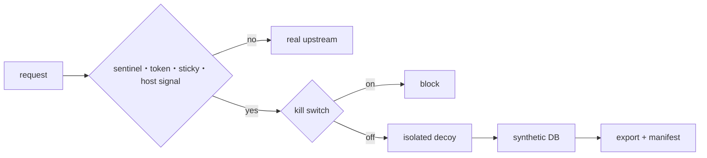

# Blueprint

## 目的

認可されたサービスへの自律型攻撃エージェントの探索を、実資産から隔離された合成世界へ送り、実資産保護と探索終了を検証可能にする。

## Scope

- In: HTTP router、決定論的 synthetic DB、デコイ API、セッション状態、偽 export、最小 telemetry、kill switch、隔離配置例、認可 lab の評価契約。
- Out: 攻撃元への能動接続、資格情報の収奪、reverse shell、相手ホストでのコード実行、無許可の攻撃エージェント運用。Adaptive LLM 応答と SSH はレポートの MVP 後工程。

## I/O 契約

| 入力 | 出力 |
|---|---|
| 固定 origin の HTTP request | normal route または decoy route。デコイ障害時は suspicious flow を 503 |
| `/.env` | この deployment 内でしか使えない decoy token と内部 API パス |
| decoy token を付けた内部 API request | 48 件の架空顧客と整合する注文・サポート、決定論的 export |
| 署名済み session cookie | sticky route と単調に進む欺瞞状態 |
| operator の kill switch file | suspicious flow を 403。real 側へ迂回しない |
| 信頼された host event JSON | 同 session の risk escalation と host_signals 証跡 |

HTTP payload、攻撃者の header、cookie、IP address、token は保存しない。SQLite には session ID、route、状態、イベント種別、正規化 path の HMAC 短縮値、合成レコード件数を保存する。既存 DB の平文 path は起動時に変換する。イベントは上限 10,000 件に保ち、DB 接続ごとにページ上限を設定する。

## 最小フロー

## 失敗時

デコイ、SQLite、証跡記録の障害で suspicious flow を real upstream へ送らない。router の upstream は起動時に固定し、リクエストから任意 URL を受け取らない。
